<!--
  Every image here is hand-made: run `python3 scripts/profile_art.py static`
  to redraw the art in svg/. The live stats are redrawn daily by
  .github/workflows/profile-images.yml into svg/live/.
-->

  

  

  

  <a href="https://kakashi250802.github.io/soar-install/">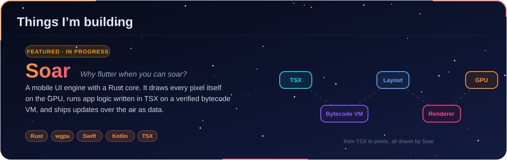</a>

  <a href="https://github.com/kakashi250802/soar-install">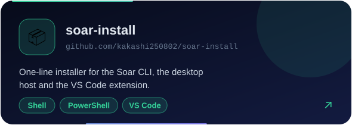</a>
  <a href="https://kakashi250802.github.io/soar-install/">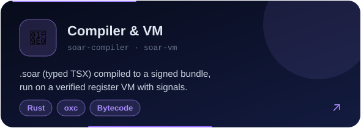</a>

  <a href="https://kakashi250802.github.io/soar-install/">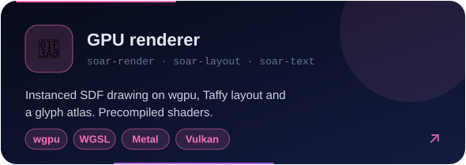</a>
  <a href="https://kakashi250802.github.io/soar-install/">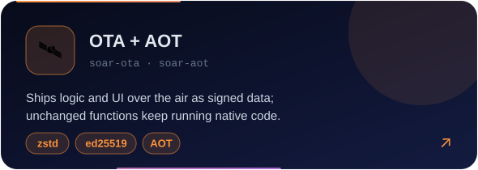</a>

<!-- Older projects, hidden for now; uncomment to show them again.

  <a href="https://github.com/kakashi250802/sleep-tracker-backend">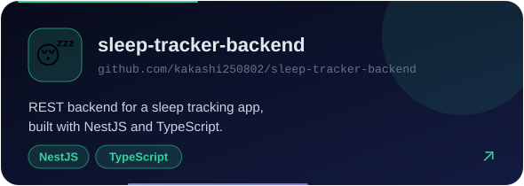</a>
  <a href="https://github.com/kakashi250802/tiktokserver">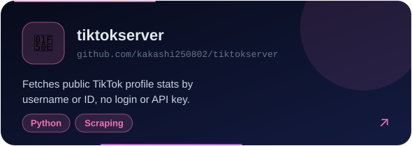</a>

  <a href="https://github.com/kakashi250802/SlackClone">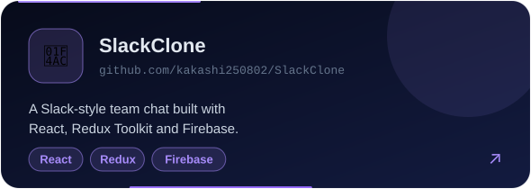</a>
  <a href="https://github.com/kakashi250802/spotifyclone">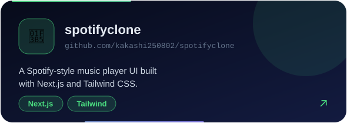</a>

-->

  

  

  

  
  &nbsp;
  
  &nbsp;
  

  

